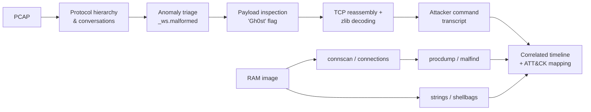
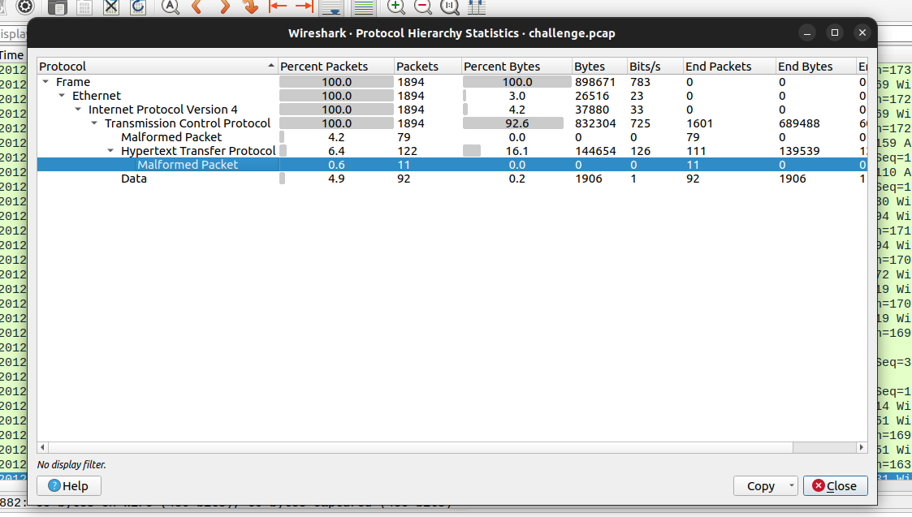
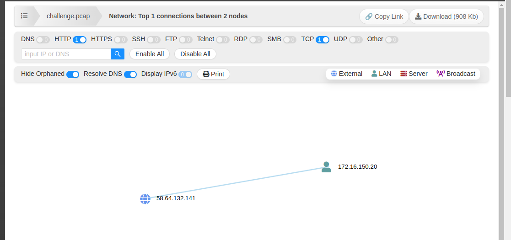
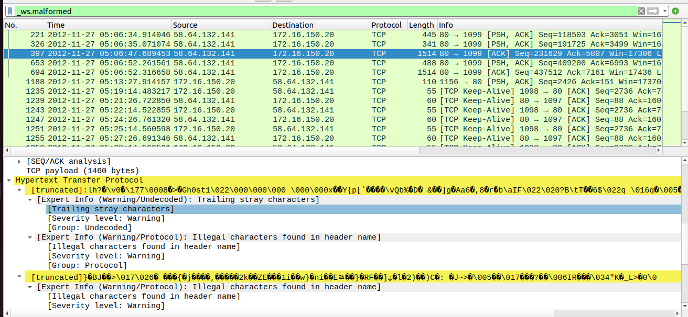
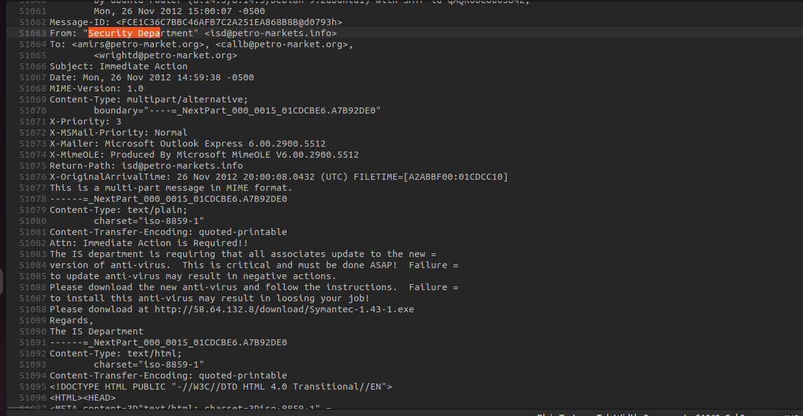
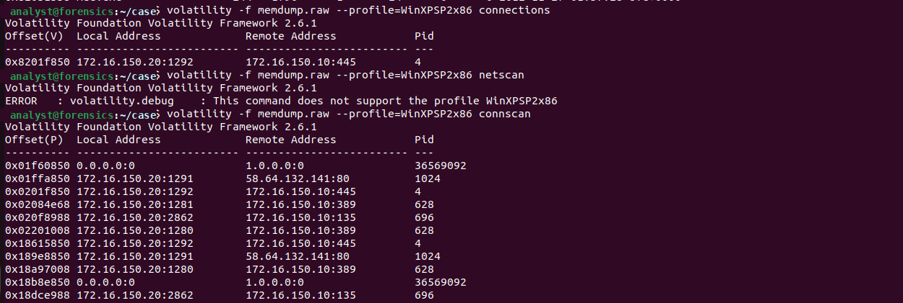
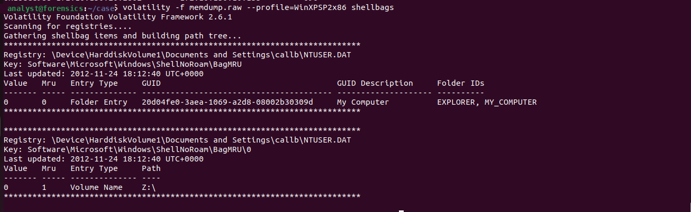

# Reconstructing a Gh0st RAT Intrusion from Network Traffic and Volatile Memory

**A forensic investigation that combines network and memory evidence to rebuild a full attack chain: spear-phishing, a remote-access trojan, credential theft, lateral movement, data exfiltration, and persistence.**


---

## Summary

A Windows XP workstation (`ENG-USTXHOU-148`, `172.16.150.20`) in the `PETRO-MARKET` domain was compromised. Starting from a packet capture and a RAM image of that host, this investigation:

1. **Identified the malware family from network traffic alone.** Wireshark labeled the C2 traffic as *malformed HTTP* on TCP/80. Payload inspection showed the `Gh0st` packet flag, which identifies the **Gh0st RAT** protocol hiding behind a web port.
2. **Decoded the attacker's encrypted session.** I wrote a stream-reassembly and decompression tool ([`tools/gh0st_decode.py`](tools/gh0st_decode.py)) that turns 1,894 opaque packets into a readable transcript of every command the operator typed.
3. **Reconstructed the full kill chain** with a minute-by-minute timeline: initial access → C2 → discovery → credential dumping → pass-the-hash → lateral movement to a domain server → exfiltration → persistence.
4. **Corroborated each network finding in memory.** Volatility recovered the C2 socket, the infected process, injected code regions, the phishing email, and the attacker's mapped network drive.
5. **Mapped the intrusion to 22 MITRE ATT&CK techniques** and extracted indicators of compromise (IOCs).

> **Key insight:** the network tool reported "malformed packets," not malware. Treating that anomaly as a signal, rather than noise, is what exposed the C2 channel.

---

## Evidence

| Artifact | Description |
|---|---|
| `challenge.pcap` | 1,894 packets, 2012-11-26 23:01 → 2012-11-27 01:34 UTC (~2.5 h), victim ↔ `58.64.132.141:80` |
| `memdump.raw` *(not included, too large)* | Physical memory of the victim host, profile `WinXPSP2x86` |
| `executable.284.exe`, `executable.628.exe`, `executable.1024.exe` | Process images (PIDs 284, 628, 1024) extracted from memory with `procdump` (**live malware, see [Safety](#safety)**) |
| `process.0x*.dmp` (11 files) | Suspicious memory regions extracted with `malfind` |
| `*.png` | Screenshots documenting each analysis step |

**Environment:** Wireshark, Volatility Framework 2.6.1, Python 3 (`dpkt`, `zlib`), `strings`, VirusTotal.

---

## Methodology



### 1. Network triage
Protocol hierarchy statistics showed that **100% of traffic was TCP between one internal host and one external IP**. About 6.4% was dissected as HTTP, and Wireshark flagged 90 packets as malformed.

<p align="center"><br><em>Protocol hierarchy: all traffic is TCP, with malformed HTTP on port 80.</em></p>
<p align="center"><br><em>A single conversation: internal host 172.16.150.20 ↔ external 58.64.132.141.</em></p>

### 2. Anomaly analysis → malware identification
Filtering on `_ws.malformed` showed binary payloads with "illegal characters found in header name." Inspecting those payloads revealed the 5-byte flag **`Gh0st`** followed by a zlib stream, the signature framing of Gh0st RAT. The attacker used port 80 so that the RAT traffic would blend in with web browsing.

<p align="center"><br><em>The <code>Gh0st</code> packet flag inside "HTTP" traffic.</em></p>

### 3. Decoding the C2 channel
Gh0st frames each message as `"Gh0st" | total_len (u32) | raw_len (u32) | zlib(payload)`. The decoder:

1. reassembles each TCP stream and discards retransmissions and keep-alives,
2. locates every `Gh0st` frame and reads the length fields, and
3. decompresses each payload, recovering the remote shell, the file manager, and transferred files.

```bash
pip install -r requirements.txt
python3 tools/gh0st_decode.py challenge.pcap
```

<p align="center"><br><em>Binary payloads that Wireshark parsed as HTTP headers, one of which begins with <code>Gh0st</code>.</em></p>

### 4. Memory forensics
```bash
volatility -f memdump.raw --profile=WinXPSP2x86 connscan              # C2 + internal sockets
volatility -f memdump.raw --profile=WinXPSP2x86 procdump -p 284 -D .  # extract process image
volatility -f memdump.raw --profile=WinXPSP2x86 malfind -D malfind/   # injected code regions
volatility -f memdump.raw --profile=WinXPSP2x86 shellbags             # user folder activity
strings memdump.raw | grep -i "58.64"                                 # phishing artifacts
```

---

## Reconstructed attack timeline (UTC)

| Time | Phase | Evidence |
|---|---|---|
| 2012-11-26 ~20:00 | **Initial access** | Spear-phishing email from look-alike domain `petro-markets.info` asks staff to install a fake "Symantec" update from `http://58.64.132.8/download/Symantec-1.43-1.exe` *(recovered from memory)* |
| 23:01:58 | **C2 established** | Victim beacons to `58.64.132.141:80` with a Gh0st login packet (hostname, OS version) |
| 23:03 | Staging | Operator opens a remote shell, creates `C:\WINDOWS\webui\` |
| 23:04 – 23:07 | **Tool transfer** | Via RAT file manager: `ps.exe` (PsExec), `wc.exe` (Windows Credentials Editor), `sl.exe` (ScanLine), `gs.exe`, `ra.exe` |
| 23:07 – 23:12 | **Discovery** | `ipconfig /all`, `net view`, `net localgroup administrators`, `net sessions`, `net share`, `net start`, ScanLine port sweep of `172.16.150.0/24`; output staged in `netuse.dll` |
| 23:13 | **Exfiltration** | `netuse.dll` (recon results) downloaded by the attacker |
| 23:15 | Target selection | Pings domain controller `DC-USTXHOU` (`172.16.150.10`) and server `IIS-SARIYADH-03` (`172.16.223.47`) |
| 23:58 – 23:59 | **Credential access** | `wc.exe -l` / `-w` dump NTLM hashes and **cleartext password** of domain user `callb` |
| 00:00 – 00:13 | **Pass-the-hash & lateral movement** | `wc.exe -s` injects stolen `sysbackup` hashes; repeated PsExec attempts against the DC and IIS server |
| 00:48 | Lateral movement | `net use z: \\172.16.223.47\z` mounts the IIS server's share |
| 00:49 – 01:15 | **Collection & exfiltration** | Copies `system.dll`, `svchost.dll`, `https.dll`, `netstat.dll` from the server; each is pulled out over C2. `svchost.dll` contains **domain credential hashes** (incl. `PETRO-MARKET\saadmin`) |
| 01:25 – 01:27 | **Persistence** | `net time` checks the DC's clock; `system5.bat` registers an `at` job: `wc.exe -e -o h.out` (continuous credential harvesting) |

<p align="center"><br><em>Phishing email recovered from the memory image.</em></p>

---

## Memory findings that confirm the network evidence

| Finding | Volatility evidence |
|---|---|
| **C2 socket** owned by **PID 1024**: `172.16.150.20:1291 → 58.64.132.141:80` | `connscan` |
| Internal SMB (445) and LDAP (389) sessions to the DC from PIDs 4 and 628, consistent with the PsExec and authentication activity | `connscan` |
| `explorer.exe` (PID 284) image flagged by **15/71** antivirus engines (SHA-256 `bf4c39e7…bb318`) | `procdump` + VirusTotal |
| Injected executable regions in multiple processes | `malfind` dumps (`process.0x*.dmp`) |
| User `callb` browsed drive **`Z:\`**, which matches the attacker's `net use z:` | `shellbags` |
| Phishing email body and payload URL | `strings` |

<p align="center"><br><em><code>connscan</code> shows the live C2 connection from PID 1024.</em></p>
<p align="center"><br><em>Extracting the <code>explorer.exe</code> process image (PID 284) with <code>procdump</code>.</em></p>
<p align="center"><br><em>The extracted image is flagged by 15 of 71 antivirus engines.</em></p>
<p align="center"><br><em><code>shellbags</code>: user <code>callb</code> browsed the attacker-mounted drive <code>Z:\</code>.</em></p>
<p align="center"><br><em><code>strings</code> on the memory image: the phishing link and the C2 address.</em></p>

---

## MITRE ATT&CK mapping

| Tactic | Technique | Observed behavior |
|---|---|---|
| Initial Access | T1566.002 Spearphishing Link | Fake IT "anti-virus update" email |
| Execution | T1204.002 Malicious File · T1059.003 Windows Command Shell | Fake Symantec installer; remote `cmd.exe` |
| Persistence / Execution | T1053.002 At | `at` job running `wc.exe -e` |
| Defense Evasion | T1036 Masquerading · T1055 Process Injection | Tools and loot renamed `*.dll`; `malfind` hits |
| Credential Access | T1003.001 LSASS Memory | WCE / `gs.exe` dumps hashes and cleartext passwords |
| Discovery | T1016, T1018, T1046, T1049, T1069.001, T1124, T1135, T1007 | `ipconfig`, `ping`, ScanLine, `net sessions/localgroup/time/share/start` |
| Lateral Movement | T1550.002 Pass the Hash · T1021.002 SMB/Admin Shares · T1569.002 Service Execution | `wc.exe -s`, `net use`, PsExec |
| Collection | T1074.001 Local Data Staging | Output collected in `C:\WINDOWS\webui\` |
| Command and Control | T1095 Non-Application Layer Protocol · T1105 Ingress Tool Transfer | Gh0st binary protocol on TCP/80; tool uploads |
| Exfiltration | T1041 Exfiltration Over C2 Channel | Recon output and credential dumps downloaded |

---

## Indicators of compromise

| Type | Value |
|---|---|
| C2 IP | `58.64.132.141` (TCP/80, Gh0st protocol) |
| Payload host | `58.64.132.8` (`/download/Symantec-1.43-1.exe`) |
| Phishing domain | `petro-markets.info` (look-alike of `petro-market.org`), sender `isd@petro-markets.info` |
| Network signature | TCP payload beginning with `47 68 30 73 74` (`Gh0st`) |
| Staging directory | `C:\WINDOWS\webui\` |
| Files | `ps.exe`, `wc.exe`, `sl.exe`, `gs.exe`, `ra.exe`, `system5.bat`, `netuse.dll`, `h.out` |
| `executable.284.exe` (SHA-256) | `bf4c39e75f3cac4c8b8cced18c34b9ed6eac2cdaed85f112c96a3e3f8d4bb318` |
| `executable.628.exe` (SHA-256) | `682cc1f99dbb82959d856fb520dcdb530ebd85541561f7b3fedf430d16529ef3` |
| `executable.1024.exe` (SHA-256) | `ad1a6c59c676257e8b138907679c3d6d9feba50f7d398487b2a38d43d51d4e9b` |

*Recovered credentials are intentionally redacted in this write-up.*

---

## Impact and recommendations

- **Scope:** one workstation fully compromised; one domain user's password and a backup account's hashes stolen; a domain server (`IIS-SARIYADH-03`) accessed, and its credential store exfiltrated. All domain credentials should be treated as compromised.
- **Containment:** block `58.64.132.0/24`, isolate `172.16.150.20` and `172.16.223.47`, and reset `callb`, `sysbackup`, `saadmin`, and the machine accounts.
- **Detection:** alert on non-HTTP payloads on port 80 (the `Gh0st` flag), on PsExec service creation, and on `at` jobs created by non-administrative users.
- **Prevention:** email domain look-alike filtering, application allow-listing, and LSASS protection against credential dumpers.

---

## Repository structure

```
.
├── README.md
├── LICENSE
├── requirements.txt
├── tools/
│   └── gh0st_decode.py                 # Gh0st RAT stream reassembler and decoder
├── challenge.pcap                      # network evidence
├── executable.{284,628,1024}.exe       # process images from memory (LIVE MALWARE)
├── process.0x*.dmp                     # malfind-extracted memory regions (11 files)
├── stat.png, Connections.png           # traffic overview
├── malformed*.png, exception_marking.png,
│   Unknown header like payload.png     # Gh0st payload identification
├── malicious_connections.png,
│   Screenshot from 2022-12-11 *.png,
│   shellbags.png, scr.png              # memory forensics
└── ...
```

## Limitations

- The memory image is not included because of its size, so the Volatility results are documented through screenshots.
- `gs.exe` and `ra.exe` were identified by behavior only. `gs.exe` output matches a credential dumper, and `ra.exe` is likely an archiver. They were not reverse-engineered.
- The decoder assumes the original, unencrypted Gh0st framing. Variants that change the flag can be handled with `--magic`.

## Safety

`executable.*.exe` and `process.*.dmp` are **real malicious samples** kept for reproducibility. Do not run them. Analyze them only inside an isolated virtual machine, and expect antivirus software to flag them when you clone the repository.


## License

[GPL-3.0](LICENSE)
